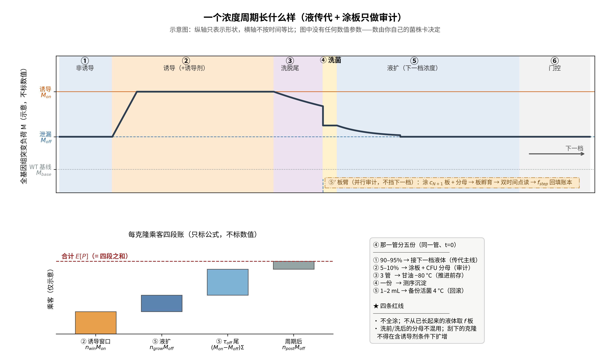
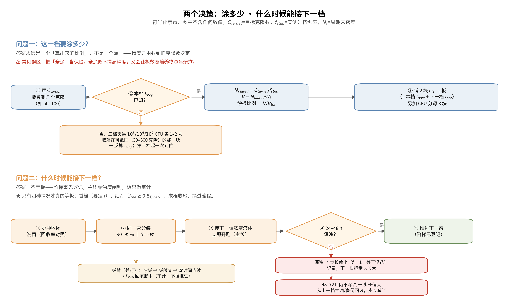
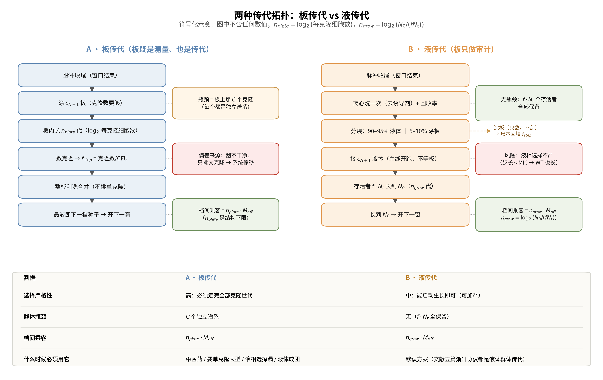

# 浓度周期的执行层——涂多少、传什么、何时能往下走

> **级别：必读②** ｜ 什么时候读我：你要走一个浓度周期（涂多少 / 传什么 / 何时能往下走） ｜ 不用读我：你只做单步窗口、不做渐升
> 入口与完整分级见 `INDEX.md`。

> 适用：mutator 育种的多靶点渐升（ramp）筛选，j≥2 的逐档账本路径。
> 本文档回答四个执行问题：**这一档的菌体要涂多少**、**剩下的去哪**、
> **下一档怎么接（板传代还是液传代）**、**能不能不等板就往下走**。
> 标注体系：[文献]（有出处）/ [推导]（本文档从文献或算术推出）/ [约定]（操作口径，按你的体系改）。
> 姊妹文档：`protocol-ramp.md`（阶梯规划与乘客账的数学）· `protocol-fstep.md`（f_step 的配对铺板、板量倒推、Wilson CI）· `multitarget-model.md`（窗口数学）· `generic-policy.md`（**本文档为什么全是符号、不给数字**）。
>
> **一句话定位**：`protocol-ramp` 管"阶梯怎么排"，`protocol-fstep` 管"f_step 怎么测"，
> **本文档管"试管与平板之间怎么倒"**——它是前两份规程之间那段没人写、但每天都要做的操作面。
>
> ⚠️ **本文档刻意不含任何具体数值**（通用性政策：见 `generic-policy.md`）。
> 所有例子都用符号（`M_on` / `M_off` / `f` / `Nt` / `N₀` / `n_win` / `n_plate`），
> 数由你自己的菌株卡与实测填。
>
> **一张图看懂整个周期** → `figures/cycle-liquid-propagation.png`（由 `figures/make_cycle_schematic.py` 生成；
> 图中同样**不含任何数值**，只画结构与公式）。用户问"一个浓度周期长什么样 / 涂板还是液传代怎么排"时，
> 直接展示这张图再按本文档解读。
>
> 

---

## 0. 一页速览

```
每档结束（脉冲收尾）那一管菌
   │
   ├─ ① 先离心洗一次（去诱导剂，无药液体重悬）        ← §3.3
   │      └ 顺手做洗菌回收率对照（洗前/洗后各 2 块）  ← §3.4
   │
   ├─ ② 分装（同一管、t=0）                          ← §3.1
   │      ├ 90–95% → 立即接下一档浓度液体（传代主线，边长大边等）  ← §6
   │      ├ 5–10%   → 涂 c_{N+1} 板 2 块 + 稀释系列 3 块          ← §2
   │      ├ 1 mL×3  → 甘油菌 −80 °C（推进前必须存）               ← §3.1
   │      └ 测序沉淀 → 验证乘客账本                                ← §3.1
   │
   ├─ ③ 24–48 h 浊度闸：长了 = 步长太小；不长 = 步长太大  ← §6.2
   │
   └─ ④ 板读出来后 → f_step = 克隆数/CFU，回填账本
          （板臂只是审计，不挡下一档——除非红灯）      ← §6
```

**三个关键关系**（都不含具体数值）：

| 量 | 怎么定 | 见 |
|---|---|---|
| 涂板比例 | `C_target/(f_step × Nt)` 反算；通常远小于 100% | §2.3 |
| 档间扩增代数 | 板传代 ≈ `log₂(每克隆细胞数)`；液传代 = `log₂(N₀/(f×Nt))` | §7.1 |
| 板量 | ≈6 块/档（共用板 2 + CFU 分母 3 + 备份 1） | §2.5 |

**两个决策画成一张图**（`figures/decide-plating-and-timing.png`，同样不含数值）：



**一句话结论**：涂板是**抽样测量**，不是**转移**；传代靠**液体**；两者同时开跑，板回来只当审计。

---

## 1. 先对齐口径：f_step 到底在说"哪个问题"

这一节是全文的地基。**不先对齐口径，后面所有数都会错。**

### 1.1 两种口径，数值不一样

同一个浓度 c 上，"能过关的比例"有两种测法，回答的是**两个不同的问题**：

| 口径 | 实际问的问题 | 需要的生长代数 | 怎么测 |
|---|---|---|---|
| **f_plate**（板计数） | 这个细胞能在 c 上**走完十几次到二十几次分裂、长成可见克隆**吗 | `log₂(每克隆细胞数)` | 涂板数克隆 / CFU |
| **f_liq**（液体生长） | 这个细胞能在 c 上**启动并维持生长**吗 | ≥1 | 限稀释 MPN / 时间到浑浊 |

[约定] 可见克隆大约等于 `log₂(每克隆细胞数)` 代——这个细胞数**按你的菌种、菌落大小实测**，
不要套别人的值（本技能不内置）。

### 1.2 所以 f_liq ≥ f_plate 是必然的，不是误差

[推导] 能在板上走完全部克隆世代数的细胞，必然能在液体里启动生长（必要条件）；
反之不成立——液体里可能是"长了一点就停"，或者靠邻居的群体耐药带着长。
所以：

```
f_liq ≥ f_plate   恒成立（弱不等式）
比值 f_liq / f_plate = "液体有多宽松"，只能实测，不能假设
```

**这不是"哪个更准"的问题，是"你要哪一个"的问题。**

### 1.3 口径必须与传代拓扑匹配

| 你怎么传代 | 决定去留的那一步发生在哪 | 账本该用哪个 f |
|---|---|---|
| **板传代**（整板刮取） | 板上（单细胞成克隆） | `f_plate` —— 板计数直接就是它 |
| **液传代**（接入下一档浓度液体） | 液体里（能不能长起来） | `f_liq` —— 板计数只是它的**下界** |

⚠️ **最容易犯的静默错误**：用液传代，但账本里填板计数的 `f_plate`。
后果：账本以为供给只有实际的一小部分，于是**多排了档数、多开了窗口**——
每一步都白付诱导成本，乘客白积。反之（板传代却填 f_liq）会**低估档数**，跑不完。
**换算系数就是 §5 的桥接验证。**

---

## 1.5 第一次开跑：首档剧本（从零到"能算"）

> 这一节只为**还没有账本**的人写。已有账本（≥2 个尾部点）请直接跳 §2。

多靶点要按顺序走，**四个阶段**，每一阶段只做该阶段的事：

| 阶段 | 判据（你手上有什么） | 该做的（按顺序） | 缺了就不给什么 |
|---|---|---|---|
| **S0** 只有菌株 | 无 MIC、无背景 | ① 测母株 MIC（肉汤稀释，标准流程）<br>② 基线梯度 3–5 点（1/2/4/8/16× MIC），每点 ≥3×10⁸ CFU → 同时得到 `f_pre(c)` | 不给 c₁、不给板量、不给窗口 |
| **S1** 有 MIC，没跑过窗口 | 无账本 | ③ 定 `c₁ = c_start × min(2.0, 目标倍数^(1/j))`（j 未知就先用 1.5–2×）<br>④ 定首窗：`N₀ ≤ Nt − k/f_guess` → `n_win = log₂(Nt/N₀)`，`f_guess` 用保守先验、宁可偏短<br>⑤ 首档铺板（见下表） | 不给 f_step 预测（还没有 PAP） |
| **S2** 首档跑完 | 账本只有 1 个浓度点 | ⑥ 过三闸（下表）<br>⑦ 在 c₁ 上下各补 1–2 个浓度点，凑到 ≥3 个尾部点<br>⑧ 洗菌 → 分装（90% 液接 / 5% 涂板 / 甘油 ×3） | 不给 δ、不给梯级（`fit_pap` 会拒绝） |
| **S3** 账本可用 | ≥2 个尾部点 | ⑨ 排梯级（`plan_ramp`）⑩ 每档 6–7 块板 ⑪ 读板回填、重跑 | — |

### 首档铺板（7 块，其中 3 块是"补点"）

| 板 | 数量 | 用途 |
|---|---|---|
| c₁ 上 10⁵ / 10⁶ / 10⁷ CFU 各 1 块 | 3 | 三档夹逼：取落在 30–300 克隆的那块 → `f_step(c₁)` |
| c₁ 上下各 1–2 个浓度点（如 0.5×、2×） | 2–4 | **给 δ 用的尾部点**——只有 1 个点算不出斜率 |
| 非选择板（稀释系列） | 3 | CFU 分母，**必须用洗后悬液** |
| 备份非选择板 | 1 | 出问题可回溯 |

> `f_pre(c₁)` 不在这批板里测——它来自 S0 的基线梯度。
> "一块板两用"（c₁ 板 = 本档 f_post + 下一档 f_pre）从**第二档**才开始。

### 首档跑完的三个闸

| 闸 | 判据 | 不通过怎么办 |
|---|---|---|
| ① 浊度闸（24–48 h） | 很快浑浊 = 步长太小（f≈1）；48–72 h 不长 = 步长太大 | 步长 ×0.5 / ×2，从上一档甘油或备份重来 |
| ② f 落在可数区 | 目标 `f ∈ 10⁻⁴–10⁻³`（此时 `k/f` 只要 10⁵–10⁷ CFU） | 太大加半步长、太小减半步长 |
| ③ 背景 | `f_pre(c₁) ≥ 0.5 × f_post` → 红灯 | 先解决假抗性/交叉污染，本档作废 |

### 四条红线

1. 首档浓度低于母株 MIC → `f≈1`，等于没选；
2. 一步跳到目标浓度 → `f` 太小，需 CFU 爆炸（板数不可行），j 步的意义消失；
3. 用 μ 和 F 推算首档 `f_step` → 技能 2026-11-13 删掉的就是这条路；
4. 没做基线体检就开跑 → 没有 `f_pre`，无法扣背景、无法判红灯。

> 命令行会把这张表直接打给你：缺 `--records` 时给 S0/S1 清单，
> 尾部点不足时给 S2 清单（两处都是 `exit 2`，不是警告）。

---

## 2. 涂多少：算出来的，不是"全涂"

### 2.1 为什么"全涂"既不可能也没必要

**不可能** [推导]：一个周期末的培养物是 `Nt × 体积` 个细胞；当 Nt 到 10⁸–10⁹/mL、
体积到 10 mL 量级时，全涂就是上百块板（一块 90 mm 板可数区只有 30–300 个克隆；
选择性板虽能承载 ~10⁷ CFU [约定]，但也不是无限）。

**没必要**：f_step 是**比例**（克隆数 / 涂板 CFU）。涂 1% 和涂 100% 估的是同一个比例，
精度只由**数到的克隆数 C** 决定，与涂了多少细胞无关（只要分母测准）。

### 2.2 精度只由克隆数决定

频率数据的 95%CI 用 Wilson 区间（Wilson 1927, JASA 22:209；
小样本优于正态近似：Brown, Cai & DasGupta 2001, Statist. Sci. 16:101 [文献]）。
经验式 **CI 相对半宽 ≈ 2/√C** [推导]（数例见 `protocol-fstep.md` §2.2）：

| 数到 C 个克隆 | 95%CI 相对半宽（Wilson，非对称端点） | 用途 |
|---|---|---|
| 3 | −66% / +194% | 只够"是/否" |
| 10 | −46% / +84% | 只判方向 |
| 30 | −30% / +43% | 探索档 |
| **50** | **−24% / +32%** | P0 阶段够用 |
| **100** | **−18% / +22%** | **推荐目标**（性价比拐点） |
| 200 | −13% / +15% | 关键档 |
| 500 | −8% / +9% | 收尾档 |

> **设计目标不是"铺够板"，是"够到目标克隆数"**——这是 `protocol-fstep.md` 的原话，
> 也是本节唯一的行动指令。

### 2.3 体积公式与比例

```
N_plated = C_target / f_step          （涂板 CFU）
V_板     = N_plated / Nt              （涂板体积）
占培养物比例 = V_板 / V_总
```

[推导] 比例只取决于 `f_step`（给定 C_target 与 Nt 时）：

| 假设的 f_step | 要 C=100 个克隆的 N_plated | 占培养物（Nt=10⁹ CFU/管，10 mL 培养物时） |
|---|---|---|
| 10⁻⁷ | 10⁹ | 100%（**唯一"整管都得涂"的情形**） |
| 10⁻⁶ | 10⁸ | 10% |
| 10⁻⁵ | 10⁷ | 1% |
| 10⁻⁴ | 10⁶ | 0.1% |
| 10⁻³ | 10⁵ | 0.01%（先稀释再涂） |

⚠ **单位口径**：这一列的 Nt 是 **CFU/管**（本技能全篇的约定），1e9 CFU/管 ≈ 10 mL × 1e8/mL。
若你手里是 **CFU/mL**，先乘体积折成 CFU/管再算——直接拿 1e9/mL 当 Nt，比例会整体高 10 倍
（这正是护栏 G3 拦的那类错）。表里数字只是**口径示例**，换成你自己的 Nt 重新算。

⚠ **"整管都得涂"≠ 精度需要全涂**：§2.1 说的是精度只由数到的克隆数 C 决定；
f_step 低到 10⁻⁷ 时要凑够 C=100 才需要涂完整管（= 1e9 CFU，约 10²–10³ 块板），
这时该改的是**加大培养体积或浓缩**（见 §2.5 的板量上限与浓缩手段），不是硬涂。

### 2.4 第一档不知道 f_step，怎么办：三档夹逼

**第一档就是预实验**——不要猜，同时涂三个量级：

```
c_{N+1} 板：10⁵ CFU ×1 块、10⁶ ×1 块、10⁷ ×1 块
```

哪一块落在 30–300 个克隆的窗口里，就用它；其余两块作废（成本 2 块板）。
**第二档起**用第一档的实测 f 反推体积，一次到位。

这与 `references/multitarget-intake.md` 的"j 三问 / 第一档即预实验"是同一条规则在实验侧的样子。

### 2.5 板量与菌种上限 [约定]

| 上限 | 做法 |
|---|---|
| 单板 CFU | ≤10⁷（90 mm；再多会连片成苔、小克隆被淹没）。要更多：150 mm 板或滤膜浓缩 |
| 团块 | 涂前必须打散（玻璃珠涡旋 / 过针头）；**团块大小会直接偏置 f_step** |
| 孢子 vs 菌丝 | 产孢子菌株的 CFU = 孢子数，不是细胞数；只比倍数不比绝对值（见 `docs/knowledge-base.md`） |

**每档板量预算**（利用"一块板两用"，见 `protocol-fstep.md` §1.2）：

| 板 | 数量 | 说明 |
|---|---|---|
| c_{N+1} 板 | 2 | **同时是**本档的 f_post 与下一档的 f_pre（同一悬液、t=0） |
| CFU 分母 | 3 | 三个稀释度各一块，**必须用洗后悬液** |
| 备份非选择板 | 1 | 可选，出问题时回溯 |
| **合计** | **6 块/档** | 档数 ×6 = 总板量 |

---

## 3. 剩下的菌体去哪

### 3.1 五个去处（同一管、同一时刻分装）

按"周期末体积 V、密度 Nt"分装 [推导]：

| 去处 | 取量 | 用途 | 硬要求 |
|---|---|---|---|
| **① 传代主线** | 90–95%（体积） | 接下一档浓度液体 | 见 §4/§6 |
| **② 涂板测量** | 5–10%（体积） | f_post/f_pre + CFU 分母 | 必须 t=0、洗后 |
| **③ 甘油菌** | 3 份（每份 1 mL + 甘油至终 15–25%） | **每档一份**，−80 °C | **推进前必须存完** |
| **④ 测序沉淀** | 一份足够测序的细胞量 | 验证乘客账本、找靶点 | 与涂板同刻 |
| **⑤ 备份活菌** | 1–2 mL | 4 °C 存放，审计红灯时快速回滚 | 见 §6.3 |

**为什么③必须"推进前"存**：如果新浓度太大不长（f≈0），主线就断了。
有上一档的甘油菌，你从 step_N 重来；没有，整条系谱归零。
文献里 16 条独立线系 7 条灭绝（`10.1038/s41467-026-74044-6` [文献]）——灭绝是常态，归档是保险。

### 3.2 诱导剂本体不回用

诱导剂是消耗品：回用会带来浓度不准 + 交叉污染 + 不知道实际浓度。
上清按实验室废液处理。**真正要管的是"携带"，不是"回收"**（§3.3）。

### 3.3 洗菌与携带：为什么建议洗一次

[推导] 板上残留的诱导剂浓度 = `C_ind × 涂板体积 / 板总体积`。
把 `C_ind`、涂板体积、板体积代进去，得到稀释倍数；再与**你自己的剂量–响应曲线**
比：要求**板上残留 < 半激活浓度的 1/10**。

| 情形 | 判断 |
|---|---|
| 涂板体积 ≪ 板体积（如 µL 级进 mL 级板） | 稀释上千倍，多半安全 |
| 涂板体积达到板体积的 1/20 以上 | 稀释不足，可能仍在激活区 → **洗一次** |
| **离心洗涤后重悬** | 稀释 ≫10³×，安全（本项目选择） |

⚠️ 洗涤本身有风险：放线菌菌丝体离心易结团，**洗后必须重新打散**再用；
否则 CFU 偏低 → f_step 偏高 → 账本低估供给。
⚠️ 若你的开关在很低浓度就激活（µM 级），上面"多半安全"的那一行不成立——用你的曲线判。

### 3.4 洗菌回收率对照（必做，与 f_step 同级）

```
回收率 = Nt(洗后) / Nt(洗前)       同一个稀释系列、同一时刻、各 2 块非选择板
```

| 回收率 | 判读 | 动作 |
|---|---|---|
| ≥90% | 正常 | 直接进账本 |
| 70–90% | 可接受 | 账本备注，N₀ 用洗后实测值 |
| 50–70% | 有损失 | 查打散是否充分 / 离心转速；N₀ 按洗后算并记录 |
| **<50%** | **不合格** | 本档降级为"方向性"；先修洗涤流程（降转速、缩短、加表面活性剂） |

**为什么必须做**：f_step 的分子来自洗后细胞、分母若来自洗前悬液，就是两套细胞在算一个比例。
`protocol-fstep.md` §2 的板量倒推全部假设"分母是同一批细胞"。

---

## 4. 传代拓扑：板传代 vs 液传代

### 4.1 两种流程

**A. 板传代**

```
脉冲结束 → 涂 c_{N+1} 板（数量要大到足够多克隆）→ 板内长到可见克隆
        → 数克隆 → 整板刮洗合并 → 悬液即下一档种子 → 开下一窗
```

**B. 液传代**（推荐默认；也是文献主流做法）

```
脉冲结束 → 洗菌 → 90% 接 c_{N+1} 液体（存活者长起来，约 log₂(N₀/(f·Nt)) 代）
                 → 长到 N₀ → 开下一窗
        └ 5% 涂 c_{N+1} 板（只数，不刮）→ 板读出来→ f_step 回填账本
```

**流程与判据对照**（`figures/propagation-topologies.png`）：



### 4.2 对比表

| 维度 | A 板传代 | B 液传代 |
|---|---|---|
| 选择严格性 | **高**：必须走完全部克隆世代数才能成克隆 | 中：能启动生长即可（可加严，§4.4） |
| 群体瓶颈 | **C 个独立谱系**（你数到几个就是几条谱系） | 无（存活者 `f×Nt` 全部保留） |
| 涂板量要求 | **必须大**（否则瓶颈更狠） | 只要够数（1–5%） |
| 档间代数 | `log₂(每克隆细胞数)`（**结构下限**） | `log₂(N₀/(f×Nt))` |
| 档间乘客 | `log₂(每克隆细胞数) × M_off` | `log₂(N₀/(f×Nt)) × M_off` |
| 单克隆表型 | 顺手就有（板上就是克隆） | 也要涂板才有，但不必刮 |
| 洗脱偏差 | **有**（刮不干净、只挑大克隆） | 无 |
| 主要风险 | 洗脱不均、菌苔污染、瓶颈 | **液体选择不严**（步长 < MIC 时 WT 也长） |
| 文献先例 | 药企板式倍增浓度（`protocol-ramp.md` §1.2） | **进化学派全部**（`protocol-ramp.md` §1.1 五篇均为液体群体传代） |

### 4.3 什么情况下必须选 A

| 情形 | 为什么必须板传代 |
|---|---|
| 药是**杀菌型**、且液体里存活者无法与"未死但也没长"区分 | 板上"长出克隆"是唯一干净判据 |
| 需要**单克隆层面**的剂量–响应（每个克隆单独测 MIC） | 板上天然分离 |
| 液体桥接后仍漏（`f_liq/f_plate` 很大且压不下去） | 只有板能给真选择 |
| 菌株在液体里**成团/贴壁**，OD 与 CFU 都不可信 | 板是唯一稳的格式 |

### 4.4 选 B 的三条护栏

1. **步长必须压在群体 MIC 之上**：下一档浓度要让"大多数细胞不能长"。
   若 24 h 就明显浑浊 → 步长太小（f≈1，等于没选）→ 立即回头、步长减小。
2. **液体判读用 CFU 增长倍数，不用单看浑浊**：48 h 取一份涂非选择板，
   比较接前/接后的 CFU。倍数 ≥5 = 真长；1–2 = 半抑制（可疑）。[约定]
3. **必须做桥接验证**（§5），把 `f_plate` 换算成 `f_liq` 再进账本。

### 4.5 文献站在哪一边

[文献] `protocol-ramp.md` §1.1 的五篇协议（pgen.1011627、aac.01414-25、
s41467-026-74044-6、science.aaj2191、ng.1034）**全部是液体群体传代**：
从"仍允许生长的最高浓度"整体取样接下一管。

**所以板传代是偏离**，偏离的理由是**膜活性药的异质性生长让 OD 不可靠**
（`protocol-ramp.md` §2.2）。液传代 + 涂板审计，等于把"判读靠 OD"换成"判读靠 CFU 增长倍数"，
既回到文献的群体传代主流，又不依赖 OD。**这是推荐 B 的核心理由。**

### 4.6 如果你还是选了 A：洗脱操作卡

1. **先计数、拍照**（刮完就再也数不了，不可逆）；
2. 挑 12–24 个代表性单克隆划线纯化 + 冻存 + 单测 MIC（个体记录，与群体传代并行）[约定]；
3. **剩余全部刮洗**：加 1–2 mL 无药液体 + 玻璃珠，涡旋 1–2 min，可短暂过针头打散；
4. 回收量通常远大于下一档 N₀，**直接够用，不要再扩增**。

四条硬规矩：
- **先数后刮**；
- **不许只挑大克隆**（偏向快生长，丢掉慢生长的潜在高抗克隆）；
- 刮下来的菌液**绝不在含诱导剂条件下扩增**——扩增 n 代就是 `n × M_on` 个乘客，
  一次就能把几档账全部吃掉；
- 回收率不要求"全"，但必须**无偏**：f_step 由计数得，不由回收量得。

---

## 5. 桥接验证：量出 f_liq / f_plate

### 5.1 为什么必须量

因为 §1.2 的不等式是**严格的**：f_liq ≥ f_plate，且比值未知。
账本吃的是 `f_liq`（你按液体选），手里有的是 `f_plate`（板计数便宜）。
**没有这个比值，账本就在用一个下界冒充真值**——档数会排多，窗口会多开。

### 5.2 三臂设计（一份悬液，三臂同时开跑）

| 臂 | 操作 | 读出 | 回答什么 |
|---|---|---|---|
| **P（板）** | 涂 10⁶/10⁷ CFU 到浓度 c 的板（2–3 块） | `f_plate = 克隆数/CFU` | 能走完全部克隆世代的比例 |
| **L（液体 MPN）** | 浓度 c 液体，限稀释：每孔 10⁵/10⁴/10³/10² 细胞各 8–12 管 | 判生长 → MPN 估 `f_liq` | 能启动生长的比例 |
| **C（反向）** | 把 L 里长起来的管，回涂浓度 c 的板 | 后代里能在 c 上成克隆的比例 | 液体"长起来"是不是真抗性 |

### 5.3 判读阈值与对策

| 观察 | 判读 | 动作 |
|---|---|---|
| `f_liq/f_plate ≈ 1–2` | 板计数是合法代理 | 继续用板计数，账本记一个系统偏移即可 |
| `f_liq/f_plate` 在 2–10 之间 | 液体偏宽松 | 账本用偏保守的值；关键档改测液体 MPN |
| **`f_liq/f_plate` ≥ 10** | **液体选择是漏的** | 三选一：加严步长 / 延长判读 / 改用板传代 |
| C 臂比例 ≪1 | 液体里"长起来"的多是半抑制细胞 | 同上；这是最硬的漏判据 |
| `f_liq < f_plate` | 几乎只可能是板上药物耗竭/卫星菌落 | 板计数偏高；查板厚、药浓度、平板均匀性 |

### 5.4 成本与时机

- **成本**：一份悬液、约 8 块板 + 30–40 管，半天布板，几天出结果；
- **时机**：**第一档做一次**，**最后一档复做一次**（比值随浓度变化：高浓度处板耗竭效应消失，比值会收窄）；
- 中途若换了培养基/温度/洗涤流程，**重做**。

---

## 6. 并行还是串行：为什么不能等板

### 6.1 四条理由（都不等）

1. **时间**：慢长菌的菌落要 **5–7 天**才可数 [约定]（`protocol-fstep.md` §1.2）。串行 = 每档多等一周。
2. **等的代价不是乘客，是分母**：静止期几乎不分裂（不积突变，这点对账本友好），
   但**活力下降、洗后 Nt 分母变陈旧**——你用"陈旧的分母"算 f_step，精度反而丢了。
3. **决策根本不需要计数**：下一档浓度是**事先登记**的阶梯（每步 1.5–2×）[约定]，
   不是看计数临时定的。**计数是审计，不是决策。**
4. **同一管分装、同一时刻开跑**，两臂从完全相同的状态出发——板臂是抽样检查，液臂是主线。

> 这一条在 `protocol-fstep.md` §1.2 已有时间线版本（"升档不串行等板"）；
> 本文档补的是**护栏**（§6.2）与**并行的代价**（§6.3）。

**拓扑不用手算代数**：`multitarget --propagation {manual,plate,liquid}` 会自己折算——
`plate` 用 `--cells-per-colony` 算 `log₂(每克隆细胞数)`；
`liquid` 用 `--nt`（+ 可选 `--n0`）算 `log₂(N₀/(f·Nt))`，
N₀ 缺省取"刚好够 k"的最大接种量 `Nt − k/f`；`manual` 才用你手填的 `--n-plate`。

### 6.2 四条护栏

| 护栏 | 阈值 | 触发后动作 |
|---|---|---|
| **① 推进前冻菌** | 每档 3 管甘油 | 没存完不许推进（硬性） |
| **② 24–48 h 浊度闸** | 24 h 明显浑浊 → 步长太小；48–72 h 不浑浊 → 步长太大 | 从上一档甘油菌（或 ③ 备份活菌）重来，步长 ×0.5 或 ×2 |
| **③ 步长由上一档实测 f 反推** | 目标 f 落在你可数的区间（见 §2.2） | 由 PAP 曲线/上一档 f 定 k，不用日历 |
| **④ 板臂必须涂 t=0 同一管** | — | 从"已长起来"的液体取样，数的是**长起来之后**的 f，当档数据作废 |

### 6.3 并行的固有代价与折中

**代价**：第 N 档的审计结果在第 N+1 档已经开跑之后才回来。所以

- 阶梯**必须事先登记**，不能实时改；
- 若审计判红灯（f≈1 或 f≈0），第 N+1 档数据**作废重做**。

**折中三条**：

1. **留一档活菌备份**（4 °C，1–2 周；不分裂不加乘客）：红灯时不从 −80 °C 复苏，省几天；
2. **首档与末档放慢**：首档是预实验（要定 f），末档要收尾复核——这两档可以等板；
3. **中间档全速**：按预设阶梯推，错了再回滚（`fork 对冲`：一档分两瓶，一瓶进下一档、一瓶在当前档重走）。

### 6.4 什么情况才真的等板

| 情形 | 为什么等 |
|---|---|
| 首档（定 f_step 量级） | 不知道 f 就没法定下一档步长与涂板量 |
| 红灯（`f_pre ≥ 0.5×f_post`，背景淹没） | 必须先解决假抗性/交叉污染（`protocol-fstep.md` §3） |
| 末档收尾 | MIC 复核 + 生长速率，判"结束" |
| 换过流程（洗涤/培养基/温度） | 旧 f 不可用，必须重测 |

---

## 7. 乘客账随拓扑怎么变

### 7.1 档间扩增代数

液传代的档间代数**不是**稀释倍数，而是"存活者长到下一档 N₀ 需要多少代"：

```
n_grow = log₂( N₀_next / (f_step × Nt) )
```

[推导] 因为下一档浓度 c_{N+1} 上只有 `f×Nt` 个细胞在分裂，其余被抑制（不分裂、也就不积突变）。

| f_step（给定 Nt、N₀） | 存活细胞 | n_grow | 档间乘客 |
|---|---|---|---|
| 越大 | `f×Nt` 越多 | 越小 | 越小 |
| 越小 | 越少 | 越大 | 越大 |

板传代则是固定下限：`log₂(每克隆细胞数)`——无论 f 多小，都得走完这么多次分裂。

### 7.2 两套账（符号形式）

| 项 | 板传代 | 液传代 | 说明 |
|---|---|---|---|
| ② 诱导窗口 | `n_win × M_on` | 同左 | 不变（开窗代数决定） |
| ⑤ 档间扩增 | `log₂(每克隆细胞数) × M_off` | `log₂(N₀/(f×Nt)) × M_off` | 本节核心差异 |
| ⑤ τ_off 尾 | `(M_on − M_off)/(e^(td/τ_off)−1)`，每次洗脱一次 | 同左 | **不变**：蛋白半衰期，与格式无关 |
| 周期后 | `n_post × M_off` | 同左 | — |
| **合计** | 四项相加 | 四项相加 | 失守概率按总乘客单次代入（`protocol-ramp.md` §3.5） |

**把你自己体系的两个数代进去，就能判断值不值得换拓扑**：
`Δ = [log₂(每克隆细胞数) − log₂(N₀/(f×Nt))] × M_off`。

### 7.3 一处常见的估算错误（本会话踩过，写下来免得再踩）

**错误做法**：把"稀释倍数"当成档间代数。
（例：把培养物稀释到 N₀，就以为走了 `log₂(Nt/N₀)` 代。）

**为什么错**：有选择时只有 `f×Nt` 个细胞在分裂，其余不分裂——代数由**存活者的数量**决定，
不是由稀释倍数决定。`log₂(Nt/N₀)` 只有在"整群都长"（f=1，即没有选择）时才成立。

**正确做法**：用 §7.1 的公式 `log₂(N₀/(f×Nt))`。判据：f 越小，代数越多。

### 7.4 代码里怎么填（`ramp.py` 的 `n_plate`）

`plan_ramp(...)` 里档间乘客只有一项 `n_plate × m_off`，它叫 `n_plate` 但**语义是"档间代数"**：

| 拓扑 | 怎么填 |
|---|---|
| 板传代 | `n_plate = log₂(每克隆细胞数)`（按你的菌落大小算） |
| 液传代 | **不用手填**：`--propagation liquid --nt <Nt>`，工具按 §7.1 算（`--n0` 可覆盖 N₀） |
| 板传代 | **不用手填**：`--propagation plate --cells-per-colony <每克隆细胞数>` |

**τ_off 尾已进模型**（2026-11-15）：给 `--tau-off-h` 与 `--td`（两者必须同时给），
账本会按 `(M_on−M_off)/(e^(td/τ)−1)` 每档加一次尾项，并写进报告"其中洗脱尾 = …"。
不给则明写"未计入"——**尾项可与板内段同量级，漏掉就是低估**，别默认它不存在。

### 7.5 乘客的杠杆排序（想省乘客，先动哪个）

| 杠杆 | 量级 | 能动吗 |
|---|---|---|
| 诱导窗口代数 `n_win` | `n_win × M_on` | 能——但代数少了供给也少，是交换不是白省 |
| **诱导泄漏 M_off** | 相对 WT 的 `M_off/M_base` 与相对诱导的 `M_on/M_off` | **优先**：泄漏先修到红线内，它决定所有非窗口段的成本 |
| τ_off 尾 | `(M_on−M_off)×Σexp(−g·td/τ)` | 半能动：洗后"空转"一段（无药长几代）可压低，代价是几代 `M_off` |
| 档间扩增代数 | `n_grow × M_off` | 能（板→液，§7.2） |
| 周期后代数 `n_post` | `n_post × M_off` | 能（到平台就收） |

---

## 8. 一个周期的操作卡（慢长菌版）

| 时刻 | 操作 | 产出/记录 |
|---|---|---|
| **T0** | 从上一档悬液接 N₀ 到诱导浓度液体（mutator 开） | `N0`、`c_window`、`t_start` |
| **窗口结束**（按预设代数，不按钟） | 停诱导 | `t_end`、`n_win` 代数 |
| **同日** | ① 离心洗一次（无药液体重悬，打散） | 洗前/洗后各 2 块 CFU → **回收率** |
| | ② 分装：90% 接 c_{N+1} 液体（主线开跑） | `N0_next` |
| | ③ 5% 涂 c_{N+1} 板 2 块 + 分母 3 块（t=0 同一管） | `cfu`、`clones`（几天后回读） |
| | ④ 甘油 3 管 + 测序沉淀 + 备份活菌 | `step_N` 归档 |
| **次日** | **24–48 h 浊度闸**：长了吗？ | 长 → 步长偏小（记录）；不长 → 步长偏大（回滚） |
| | 若已长到 N₀ → 开下一窗（回 T0） | 下一档 |
| **板读出日** | 读板 → `f_step = clones/cfu`（含 Wilson CI、背景扣除） | 回填账本，重跑 `multitarget` |

**每档必录**（写进账本 `cycle,c,when,cfu,clones`）：

```
cycle, c, when(post), cfu, clones      ← 共用板（= 下一档的 pre）
cycle, c, when(pre),  cfu, clones      ← 首档/换流程时的基线
另附：N0, Nt, 洗菌回收率, n_win, n_grow, 判读时刻, f_liq/f_plate(若做过桥接)
```

---

## 9. 红线（七件不许做的事）

| # | 不许 | 后果 |
|---|---|---|
| 1 | 把全部菌体都涂板 | 板数爆炸，且不会提高精度 |
| 2 | 从"已经长起来"的液体取 f 板 | 数的是长起来之后的频率，当档数据作废 |
| 3 | 涂板悬液不洗（当携带显著时） | 诱导剂携带 → 板内持续诱导 → f 与 τ 尾都被污染 |
| 4 | 洗前测分母、洗后涂板（或反之） | 两批细胞算一个比例，f_step 系统性偏差 |
| 5 | 洗脱时只挑大克隆 | 偏差：偏向快生长，丢掉慢生长高抗克隆 |
| 6 | 用板计数直接当液传代的 f | 用的是下界，档数排多、窗口多开（§1.3） |
| 7 | 没存甘油菌就推进 | 该档灭绝 = 整条系谱归零；而灭绝是常态 |

---

## 10. 现在还是"要你自己测"的数

本文档**不含任何具体数值**（通用性政策）。下面这些量必须来自你自己体系，
且**每一个都会改变结论**：

| 量 | 从哪来 | 影响什么 |
|---|---|---|
| `M_on` / `M_off` / `M_base` | 你的波动实验（`rate`）+ 诱导/泄漏表征 | 窗口乘客、泄漏地板价、杠杆排序 |
| `τ_off` / `td` | 洗脱时间序列 + 生长曲线（`fit-tauoff`） | τ 尾（最大可动项之一） |
| `Nt` / `N₀` / 每克隆细胞数 | 平板计数 + 菌落形态 | 涂板体积、`n_grow`、板传代下限 |
| `f_step` | 每档配对铺板（`protocol-fstep.md`） | 档数、板量、供给 |
| `f_liq/f_plate` | 本文档 §5 的桥接 | 账本的供给换算 |
| 洗菌回收率 | 本文档 §3.4 | f_step 的分母 |
| 板上残留诱导剂的半激活点 | 你的开关剂量曲线 | 要不要洗 |

---

## 11. 引用

本档新引（其余见 `protocol-fstep.md` §7 / `protocol-ramp.md` §6）：

1. **Wilson, E.B. (1927)** Probable inference, the law of succession, and statistical inference. *JASA* 22:209. —— Wilson 区间。
2. **Brown, Cai & DasGupta (2001)** Interval estimation for a binomial proportion. *Statist. Sci.* 16:101. —— 小样本下 Wilson 优于正态近似。
3. **Hanley & Lippman-Hand (1983)** If nothing goes wrong, is everything all right? *JAMA* 249:1743. —— rule of three（零事件上界 3/n）。
4. **Toprak et al. (2012)** Evolutionary paths to antibiotic resistance under dynamically sustained drug selection. *Nat Genet* 44:101（`10.1038/ng.1034`）—— 液体群体传代 / OD 驱动的升档判据。
5. **Leyva et al. (2025)**（`10.1371/journal.pgen.1011627`）—— "从仍允许生长的最高浓度孔整体收集转接"。
6. **AAC 2026**（`10.1128/aac.01414-25`）—— "cultures from the highest antibiotic concentration that still permitted growth were used for the following day"。
7. **Nat Commun 2026**（`10.1038/s41467-026-74044-6`）—— 16 条独立线系 7 条灭绝；单克隆只在终点分离。
